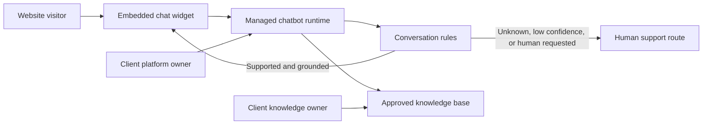

# Solution Design

## 1. Proposed toolset

### Reference choice: Botpress Cloud

Botpress Cloud is the reference choice because it provides a managed webchat widget, knowledge bases, conversation workflows, logs, and client-manageable workspaces without requiring custom hosting.

Before kickoff, the freelancer must demonstrate that the selected plan supports the required document volume, monthly conversations or AI usage, website domains, retention controls, collaborator access, and handover. Current prices and limits must be copied into the approved quote from the provider's official pricing page; this document intentionally does not freeze a price that may change.

### Equivalent tools

An alternative such as Voiceflow, Chatbase, Tidio, or another managed platform is acceptable only if it provides:

- Client-owned accounts and exportable content.
- A website widget compatible with the client's site.
- Knowledge-grounded responses and controllable fallback behavior.
- Usage and recurring-cost visibility.
- Appropriate privacy, retention, and access controls.
- A practical non-developer content-update workflow.

Changing tools after configuration starts is a scope change unless the original tool cannot meet an agreed requirement.

## 2. Logical architecture

No order database, payment system, customer account, or CRM is connected in the initial scope.

## 3. Answer policy

The system instruction should enforce these rules:

1. Answer store-policy and product questions only from approved knowledge.
2. Prefer concise, direct answers and include relevant conditions or exceptions.
3. Ask one clarifying question when the request is ambiguous.
4. Say when information cannot be confirmed; do not fill gaps from general knowledge.
5. Offer human support for unknown, disputed, sensitive, account-specific, or action-oriented requests.
6. Never request passwords, payment-card details, or unnecessary personal data.
7. Never claim an action was completed when no integration exists.
8. Follow the approved brand voice without weakening policy accuracy.

Exact instructions are configured and tested in the platform rather than committed with secrets or client data.

## 4. Conversation paths

### Supported question

1. Identify the topic and relevant approved source.
2. Answer the question directly.
3. Include conditions that materially affect the answer.
4. Link to an approved policy or product page when useful.
5. Offer human help only when the user needs more assistance.

### Ambiguous question

1. Ask one focused clarifying question.
2. Answer if the clarification maps to approved content.
3. Fall back if uncertainty remains.

### Unsupported or low-confidence question

Suggested response pattern:

> I cannot confirm that from the store information available to me. Please contact [support channel] for help. [Hours or response-time wording, only if approved.]

The bot must not present a plausible-sounding guess before this fallback.

### Human requested

Immediately provide the approved support route. Do not force the visitor through additional automated questions.

### Account-specific request

Explain that the chat cannot access customer accounts or orders, then provide the support route. Do not ask the visitor to paste sensitive order or payment information unless the client has separately approved a secure collection workflow.

## 5. Knowledge organization

Recommended source groups:

- `shipping-policy`
- `returns-and-exchanges`
- `sizing-and-fit`
- `product-information`
- `contact-and-support`

Each source should have an owner, effective date, review date, and public canonical URL where available. Duplicate and superseded versions must be removed to prevent contradictory retrieval.

## 6. Widget configuration

Configure only client-approved values:

- Bot display name and greeting.
- Brand colors and icon.
- Launcher position and mobile spacing.
- Privacy notice or policy link if required.
- Human-support button or link.
- Allowed production and staging domains where supported.
- Conversation retention and transcript settings.

The embed should load asynchronously where the platform supports it and must not contain a private administrative token.

## 7. Environments and release flow

Preferred flow:

1. Configure with synthetic test data in a client-owned development or staging bot.
2. Run the agreed tests in staging.
3. Obtain written approval.
4. Publish the accepted configuration to production.
5. Install or enable the production widget.
6. Run smoke tests and retain a rollback path.

If the platform does not provide separate environments, export or record the accepted configuration and schedule a controlled publish window.

## 8. Recurring costs

Potential recurring charges include:

- Chatbot platform subscription.
- AI or message usage above included quotas.
- Additional collaborators, storage, or retention.
- Helpdesk or third-party integrations added later.

The client pays providers directly from client-owned billing accounts. Before approval, the quote must state the selected plan, billing currency, taxes if known, included usage, overage behavior, cancellation terms, and who monitors consumption. No paid upgrade may be enabled without client approval.

## 9. Observability

During the launch and support period, review platform-provided metrics for:

- Unanswered or fallback questions.
- Repeated misunderstood wording.
- Policy contradictions or stale sources.
- Usage approaching plan limits.
- Widget or integration errors.

Conversation review must follow the client's privacy policy and avoid exporting personal data unless necessary and authorized.
